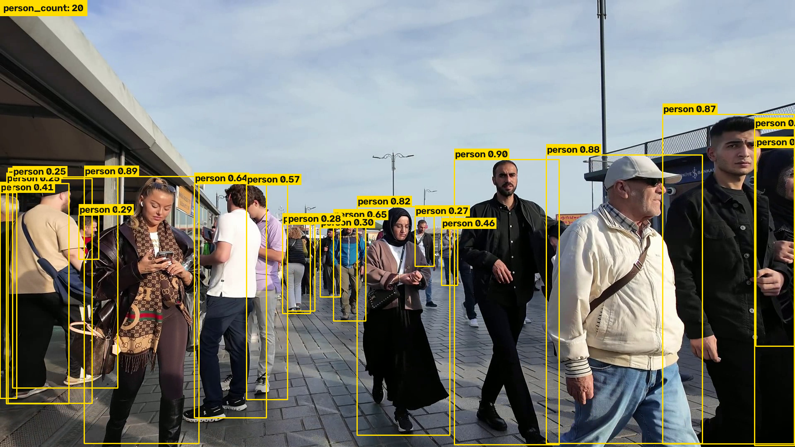
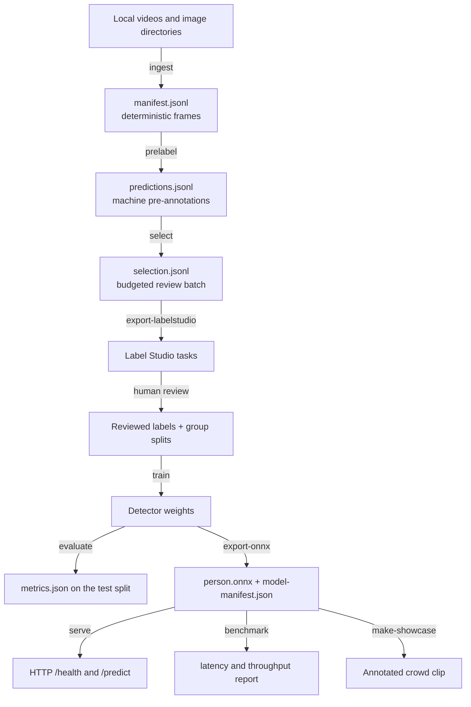

# VisionOps

[](https://github.com/ginzburg-dev/visionops/actions/workflows/ci.yml)
[](LICENSE)

Person detection and counting in video, from raw footage to a served model.
VisionOps turns local video into a reviewable dataset, trains and evaluates a detector,
exports it to ONNX, and serves it over HTTP on CPU.



*YOLO11n detections on a street clip: 240 frames, 5 to 20 people per frame. Rendered by
`make-showcase`; source and licence in [assets/README.md](assets/README.md).*

## Features

- `train` refuses unreviewed labels, paths that point back at pre-label output, a missing
  test split, or a source group that appears in two splits
- ONNX exports are verified against the source detector on sample frames, with the deltas
  and tolerances recorded in `model-manifest.json`
- Every artifact records its provenance: source paths, per-image SHA-256, model hashes,
  thresholds, package versions, platform
- Deterministic frame ingest and seeded review-batch selection
- Serving runs on ONNX Runtime alone, with no PyTorch at inference time
- Nothing is downloaded at runtime: media, weights, and datasets are local paths

## Architecture



Every arrow is a command over a versioned JSONL or JSON contract.

## Quickstart

```bash
make sync      # uv sync --extra dev
make quality   # ruff check, formatter check, pytest
uv run python -m visionops --help
```

`make help` lists the rest. Every target is a one-line wrapper over `uv`.

Ingest, pre-annotate, and build a review batch:

```bash
uv run python -m visionops ingest --input data/raw/clip.mp4 --out data/pool --stride 5 --seed 0
uv run python -m visionops prelabel --manifest data/pool/manifest.jsonl --model models/yolo11n.pt --out data/pool/predictions.jsonl
uv run python -m visionops select --predictions data/pool/predictions.jsonl --out data/pool/selection.jsonl --budget 200 --strategy uncertainty --seed 0
uv run python -m visionops export-labelstudio --selection data/pool/selection.jsonl --out data/pool/tasks.json
```

## Commands

| Command | Purpose | Key arguments |
| --- | --- | --- |
| `ingest` | Extract frames from videos and image directories into `images/` plus `manifest.jsonl`. | `--input --out --stride --max-frames --seed --group` |
| `prelabel` | Run a local detector over a manifest and write person predictions. | `--manifest --model --out --confidence --iou --device` |
| `select` | Pick a review batch under a frame budget, randomly or by uncertainty and diversity. | `--predictions --out --budget --strategy --seed` |
| `export-labelstudio` | Convert a selection into Label Studio tasks with pre-annotations. | `--selection --out` |
| `train` | Train a detector from reviewed labels and record the run. | `--config --out --seed --weights --epochs --imgsz --device` |
| `evaluate` | Score a detector on the held-out test split. | `--config --model --out` |
| `export-onnx` | Export to ONNX, validate the input shape, check parity, write `model-manifest.json`. | `--model --out --imgsz --sample-images` |
| `serve` | Start the ONNX-only HTTP API. | `--model --host --port --max-upload-bytes` |
| `benchmark` | Measure CPU latency and throughput on local images. | `--model --images --out --warmup --iterations` |
| `make-showcase` | Render an annotated clip from local footage with provenance. | `--video --model --out --start-s --duration-s --source-url --license --attribution` |

Run `uv run python -m visionops <command> --help` for the full argument list.

## Dataset review

`prelabel` writes predictions; `export-labelstudio` turns them into Label Studio tasks
marked `review_required: true`. A person corrects and accepts each frame there, and `train`
reads what came back from that review.

`train` and `evaluate` read a dataset config that declares the review and points at an
ordinary YOLO data YAML plus a group manifest:

```yaml
# dataset.yaml
data_yaml: data.yaml
group_manifest: groups.jsonl
labels_reviewed: true
```

```jsonl
{"split_group": "camera-a", "split": "train"}
{"split_group": "camera-b", "split": "val"}
{"split_group": "camera-c", "split": "test"}
```

Frames from one source stay in a single split.

## Provenance

| Artifact | Records |
| --- | --- |
| `manifest.jsonl` | Source path, source group, frame index, timestamp, size, and the SHA-256 of each image. |
| `predictions.jsonl` | Model id, model SHA-256, and both thresholds, per frame. |
| `training-run.json` | Resolved arguments, seed, dataset config hash, starting weights hash, package versions, platform. |
| `metrics.json` | Precision, recall, mAP@50, mAP@50-95 on the test split, with model and config hashes. |
| `model-manifest.json` | Preprocessing, thresholds, opset, class map, hashes, versions, and the measured export parity. |
| `crowd-showcase.json` | Source hash, licence, attribution, frame rate, frame count, per-frame `person_count`. |

## HTTP API

```bash
uv run python -m visionops serve --model models/person.onnx --host 127.0.0.1 --port 8000
curl -s http://127.0.0.1:8000/health
curl -s -X POST http://127.0.0.1:8000/predict -F "file=@frame.jpg;type=image/jpeg"
```

`/predict` returns `person_count`, the detections, the image size, and the model identity.
Failures come back as `{"error": {"code": ..., "message": ...}}`:

| Status | Cause |
| --- | --- |
| `415` | Unsupported content type |
| `413` | Over the upload limit, 10 MB by default |
| `400` | Bytes that do not decode as an image |
| `503` | `model_unavailable`: the model could not be loaded |

## Docker

```bash
docker build -t visionops:local .
docker run --rm -p 8000:8000 -v "$PWD/models:/models:ro" visionops:local
```

645 MB, runs as a non-root user, healthchecks `/health`, and reports healthy within
seconds. Mount the model at `/models/person.onnx` or override `VISIONOPS_MODEL`.

## Measured results

Measured with the stock `yolo11n.pt` COCO weight, passed in as a local file.

**Export parity** — `models/model-manifest.json`

The ONNX Runtime detector against the Ultralytics source detector, on five 1920x1080 frames
carrying 24 person detections, at opset 12 and a fixed 640x640 input:

| Measure | Measured | Tolerance |
| --- | --- | --- |
| Largest box corner difference | 0.00018 px | 2.0 px |
| Largest confidence difference | 0.0000013 | 0.02 |

**CPU latency** — `experiments/runs/benchmark-yolo11n.json`

Thirty timed single-image runs after five warmups over those same frames, on Windows 11,
Python 3.11.16, ONNX Runtime `CPUExecutionProvider`:

| mean | p50 | p95 | throughput |
| --- | --- | --- | --- |
| 29.4 ms | 29.2 ms | 31.5 ms | 34.0 images/s |

**Crowd showcase** — `assets/crowd-showcase.json`

An 8.008 second window, 240 frames at 29.97 fps and 1920x1080, through the same model at
confidence 0.25 and IoU 0.7:

| Frames | People per frame | Mean | Busiest frame |
| --- | --- | --- | --- |
| 240 | 5 to 20 | 13.2 | 20 |

## Scope and limitations

- Person class only. No faces, identities, tracking, re-identification, or density maps.
- Uncertainty selection scores confidence ambiguity around 0.5 and image diversity by
  difference hash. It is a heuristic, not a calibrated acquisition function.
- Parity is measured on the sample images you pass to `export-onnx`, at the tolerances in
  `model-manifest.json`. It holds while both paths letterbox the same way: bilinear, to a
  square canvas.
- The ONNX decoder expects a YOLO-style output of 4 box values followed by class scores, in
  either `[1, attributes, anchors]` or `[1, anchors, attributes]` layout. Anything else fails
  with the observed shape rather than guessing.

## Third-party components

VisionOps is the `visionops/` package, released under the [MIT licence](LICENSE). It depends
on projects with their own terms:

- **Ultralytics YOLO** — optional, for local training, prediction, and ONNX export
  (`uv sync --extra train`). AGPL-3.0, with a commercial licence available from its authors;
  check which applies before shipping anything built with it. Serving never imports it.
- **ONNX Runtime** — inference at serving time.
- **OpenCV** and **NumPy** — decoding, preprocessing, overlay rendering.
- **FastAPI** and **Uvicorn** — the HTTP layer.
- **Label Studio** — the review tool the export targets, neither bundled nor redistributed.

You are responsible for the rights to the media, datasets, and weights you pass in, and for
the terms of any clip you publish from `make-showcase`.
