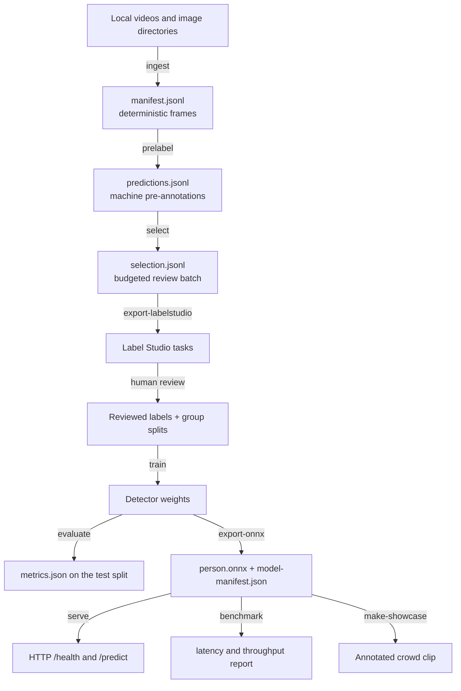

# VisionOps

A command-line pipeline for person detection in crowded scenes: it turns local video and
image files into a reviewable dataset, wraps detector training and held-out evaluation,
exports the detector to ONNX with a parity check, and serves CPU inference over HTTP.

A prediction contains one bounding box and confidence per detected person plus
`person_count`, computed from the final filtered detections. VisionOps does not identify
people, recognise faces, track identities between frames, or estimate crowd density.

## Architecture



Every arrow is an explicit command over a versioned JSONL or JSON contract. Nothing is
downloaded at runtime: media, weights, and datasets are passed in as local paths.

## Quickstart

```bash
uv sync --extra dev
uv run pytest -q
uv run python -m visionops --help
```

Ingest frames, pre-annotate them with a local detector, and build a review batch:

```bash
uv run python -m visionops ingest --input data/raw/clip.mp4 --out data/pool --stride 5 --seed 0
uv run python -m visionops prelabel --manifest data/pool/manifest.jsonl --model models/yolo11n.pt --out data/pool/predictions.jsonl
uv run python -m visionops select --predictions data/pool/predictions.jsonl --out data/pool/selection.jsonl --budget 200 --strategy uncertainty --seed 0
uv run python -m visionops export-labelstudio --selection data/pool/selection.jsonl --out data/pool/tasks.json
```

## Commands

| Command | Purpose | Key arguments |
| --- | --- | --- |
| `ingest` | Extract frames from videos and image directories into `images/` plus `manifest.jsonl`. | `--input --out --stride --max-frames --seed --group` |
| `prelabel` | Run a local detector over a manifest and write person predictions. | `--manifest --model --out --confidence --iou --device` |
| `select` | Pick a review batch under a frame budget, randomly or by uncertainty and diversity. | `--predictions --out --budget --strategy --seed` |
| `export-labelstudio` | Convert a selection into Label Studio tasks with pre-annotations. | `--selection --out` |
| `train` | Train a detector from reviewed labels and record the run. | `--config --out --seed --weights --epochs --imgsz --device` |
| `evaluate` | Score a detector on the held-out test split. | `--config --model --out` |
| `export-onnx` | Export to ONNX, validate the input shape, check parity, write `model-manifest.json`. | `--model --out --imgsz --sample-images` |
| `serve` | Start the ONNX-only HTTP API. | `--model --host --port --max-upload-bytes` |
| `benchmark` | Measure CPU latency and throughput on local images. | `--model --images --out --warmup --iterations` |
| `make-showcase` | Render an annotated clip from local footage with provenance. | `--video --model --out --start-s --duration-s --source-url --license --attribution` |

Run `uv run python -m visionops <command> --help` for the full argument list.

## Where review fits

`prelabel` output is a machine prediction, never a label. Predictions are exported to
Label Studio as pre-annotations with `review_required: true`, and a human corrects and
accepts every frame before it can be used for training.

`train` and `evaluate` read a VisionOps dataset config that must set `labels_reviewed: true`
and point at an ordinary YOLO data YAML plus a group manifest:

```yaml
# dataset.yaml
data_yaml: data.yaml
group_manifest: groups.jsonl
labels_reviewed: true
```

```jsonl
{"split_group": "camera-a", "split": "train"}
{"split_group": "camera-b", "split": "val"}
{"split_group": "camera-c", "split": "test"}
```

Training refuses to start when the reviewed marker is missing, when a path points at
prediction or pre-label output, when the test split is absent, or when one source group
appears in more than one split. Frames from the same source never straddle a split.

## Provenance

- `manifest.jsonl` records the source path, source group, frame index, timestamp, size, and
  the SHA-256 of each extracted image.
- `predictions.jsonl` records the model id, model SHA-256, and both thresholds per frame.
- `training-run.json` records the resolved arguments, seed, dataset config hash, starting
  weights hash, package versions, and platform.
- `metrics.json` records precision, recall, mAP@50, and mAP@50-95 on the test split, with the
  model and config hashes.
- `model-manifest.json` records preprocessing (letterbox, input size, pad value, RGB, NCHW),
  thresholds, opset, class map, hashes, versions, and the measured export parity.
- `crowd-showcase.json` records the source hash, licence, attribution, frame rate, frame
  count, and per-frame `person_count`.

## HTTP API

```bash
uv run python -m visionops serve --model models/person.onnx --host 127.0.0.1 --port 8000
curl -s http://127.0.0.1:8000/health
curl -s -X POST http://127.0.0.1:8000/predict -F "file=@frame.jpg;type=image/jpeg"
```

A successful `/predict` returns `person_count`, the detections, the image size, and the model
identity. Client problems return a structured 4xx body
(`{"error": {"code": ..., "message": ...}}`): `415` for an unsupported content type, `413`
above the upload limit (10 MB by default), `400` for bytes that do not decode. If the model
cannot be loaded, both routes return `503` with `model_unavailable`. Serving uses ONNX
Runtime only; there is no PyTorch fallback.

## Docker

```bash
docker build -t visionops:local .
docker run --rm -p 8000:8000 -v "$PWD/models:/models:ro" visionops:local
```

The image is a slim CPU image, runs as a non-root user, and declares a healthcheck against
`/health`. Mount the ONNX model at `/models/person.onnx` or override `VISIONOPS_MODEL`.

## Measured results

This section is reserved for numbers measured on this checkout. It is empty on purpose:

- No detector has been trained here, so there are no precision, recall, or mAP figures.
- No real model has been exported to ONNX here, so there is no export parity measurement and
  no latency or throughput figure.
- The real crowd showcase has not been rendered; see [assets/README.md](assets/README.md) for
  the source gates and the exact command.

What has been verified on this checkout is listed in the delivery notes below. Do not publish
an accuracy or speed claim that is not backed by a `metrics.json`, `model-manifest.json`, or
benchmark report file produced by these commands.

## Verified on this checkout

- `uv run ruff check .`, `uv run ruff format --check .`, and `uv run pytest -q` pass.
- The fixture smoke path runs end to end: `ingest` → fixture predictions → `select` →
  `export-labelstudio`, with the emitted JSON parsed back.
- ONNX Runtime is exercised for real against a tiny constant-output fixture model: the
  session loads, preprocessing and decoding run, and the full command chain
  `ingest` -> `prelabel` -> `select` -> `export-labelstudio` -> `benchmark` completes.
- A live `serve` process answered `200` on `/health`, `200` on `/predict` with the expected
  `person_count`, and `415` on an unsupported content type. The benchmark timings from that
  fixture model measure the harness, not a detector, and are not reported as model
  performance.
- The Docker image has **not** been built here: the Docker daemon was not running on this
  machine. `docker build -t visionops:local .` is unverified.
- Training, evaluation, and ONNX export are covered through injected trainers, evaluators,
  and exporters; the Ultralytics-backed paths need `uv sync --extra train` and local weights.

## Limitations

- Person class only. No faces, identities, tracking, re-identification, or density maps.
- Uncertainty selection scores confidence ambiguity around 0.5 and image diversity by
  difference hash; it is a heuristic, not a calibrated acquisition function.
- Export parity is checked on the sample images you pass in, at the tolerances recorded in
  `model-manifest.json`. It is evidence about those samples, not a general guarantee.
- The benchmark measures single-image CPU latency on the machine that runs it. Numbers do not
  transfer between machines.
- The ONNX decoder expects a YOLO-style output of 4 box values followed by class scores, in
  either `[1, attributes, anchors]` or `[1, anchors, attributes]` layout; anything else fails
  with the observed shape rather than guessing.

## Third-party components and responsibilities

VisionOps code is the content of the `visionops/` package. It is separate from, and depends
on, the following projects, each under its own licence and terms:

- **Ultralytics YOLO** — optional, used only for local training, prediction, and ONNX export
  (`uv sync --extra train`). It is AGPL-3.0 licensed, with a separate commercial licence
  available from its authors; check which applies to your use before shipping anything built
  with it. Serving never imports it.
- **ONNX Runtime** — inference at serving time.
- **OpenCV** and **NumPy** — decoding, preprocessing, and overlay rendering.
- **FastAPI** and **Uvicorn** — the HTTP layer.
- **Label Studio** — the review tool the export targets; it is not bundled or redistributed.

You are responsible for the rights to the media, datasets, and model weights you pass into
these commands, and for the terms of any clip you publish from `make-showcase`. This
repository redistributes no footage, no datasets, and no weights.
